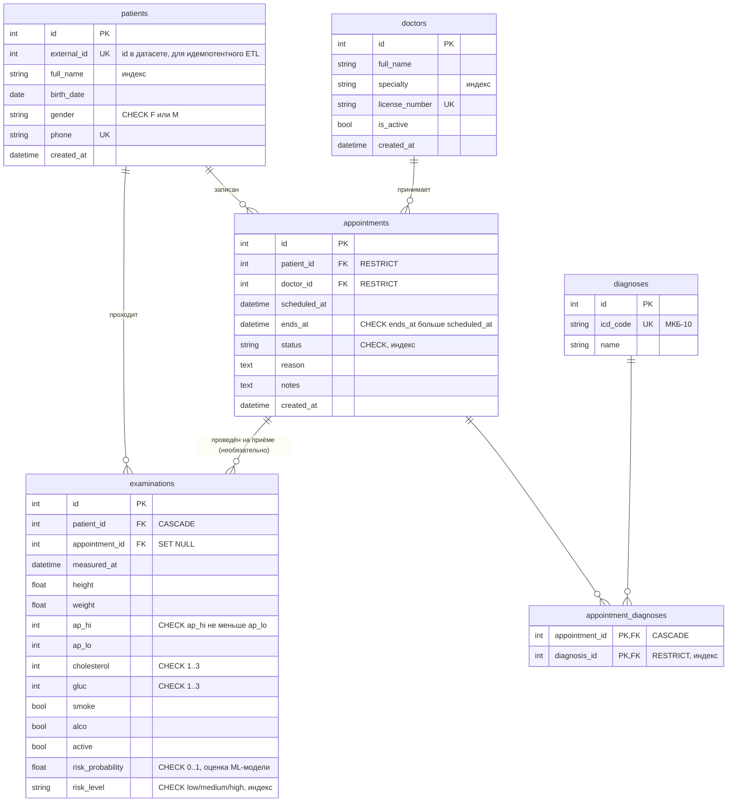

# ERD

Схема создаётся только миграциями Alembic (`migrations/versions/20261108_0001_create_clinic_schema.py`).
Тест `tests/test_migrations.py::test_models_match_migrations` следит, чтобы модели и миграции не расходились.

## Сущности

| Таблица | Назначение |
|---|---|
| `patients` | Пациенты клиники. Импортированные из датасета имеют `external_id`, созданные вручную — нет. |
| `doctors` | Врачи. Неактивного врача (`is_active = false`) нельзя записать на приём. |
| `appointments` | Приёмы: пациент, врач, интервал времени, статус `scheduled → completed / cancelled / no_show`. |
| `diagnoses` | Справочник диагнозов МКБ-10. |
| `appointment_diagnoses` | Ассоциативная таблица **многие-ко-многим**: диагнозы, поставленные на приёме. |
| `examinations` | Результаты медосмотров и оценка риска от ML-модели. |

## Связи

- **Один-ко-многим**: пациент → приёмы, врач → приёмы, пациент → осмотры, приём → осмотры.
- **Многие-ко-многим**: приёмы ↔ диагнозы через `appointment_diagnoses`.

## Ограничения целостности

- `NOT NULL` на всех обязательных полях; `UNIQUE`: `patients.phone`, `patients.external_id`, `doctors.license_number`, `diagnoses.icd_code`.
- `CHECK`: пол, статус приёма, `ends_at > scheduled_at`, диапазоны холестерина и глюкозы (1–3), `ap_hi >= ap_lo`,
  положительные рост и вес, `risk_probability` от 0 до 1, `risk_level` из трёх значений.
- **Частичный уникальный индекс** `uq_appointments_doctor_active_slot (doctor_id, scheduled_at) WHERE status IN ('scheduled', 'completed')`:
  у врача не может быть двух действующих приёмов на одно время, но отменённый приём слот не занимает.
- Внешние ключи: врача и пациента с приёмами удалить нельзя (`RESTRICT`); осмотры удаляются вместе с пациентом (`CASCADE`).

## Индексы

| Индекс | Зачем |
|---|---|
| `patients(full_name)` | поиск пациентов по ФИО |
| `doctors(specialty)` | фильтр врачей по специальности |
| `appointments(doctor_id, scheduled_at)` | проверка занятости врача, самый частый запрос при записи |
| `appointments(patient_id, scheduled_at)` | проверка занятости пациента, история приёмов |
| `appointments(status)` | фильтр по статусу |
| `examinations(patient_id, measured_at)` | история осмотров, последний осмотр пациента |
| `examinations(measured_at)` | динамика риска по периодам |
| `examinations(risk_level)` | отчёт «высокий риск без приёма» |
| `appointment_diagnoses(diagnosis_id)` | топ диагнозов |
