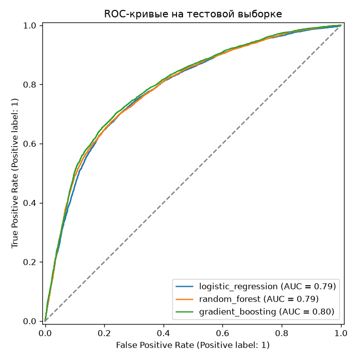

# ML-модуль: оценка сердечно-сосудистого риска (лабораторная №10)

Лабораторная работа №10 по дисциплине «Программирование на Python».

ML-сервис оценивает риск сердечно-сосудистого заболевания по данным медосмотра пациента: возраст, рост, вес, давление, холестерин, глюкоза.
Backend — FastAPI, модель — scikit-learn, интерфейс — HTML/JS без фреймворков.

> Это учебный проект, а не медицинское изделие: оценка модели не является диагнозом.

## Результаты

| Модель | ROC-AUC (5-fold CV) | ROC-AUC (тест) |
|---|---|---|
| Логистическая регрессия | 0.7910 ± 0.0025 | 0.7855 |
| Случайный лес | 0.7887 ± 0.0028 | 0.7890 |
| **Градиентный бустинг** (`HistGradientBoostingClassifier`) | **0.7997 ± 0.0029** | **0.7955** |

Лучшая модель выбирается по средней ROC-AUC на кросс-валидации, а тестовая выборка нужна только для итоговой оценки.
Модель сохранена в `models/model.pkl`, метрики — в `reports/metrics.json`, ROC-кривые — в `reports/roc_curves.png`.

> **Эталонный отчёт.** Файлы в `reports/` — результат последнего обучения, который лежит в репозитории для наглядности.
> Они перегенерируются командой `python -m ml.train` и после переобучения могут отличаться.
> `models/model.pkl` — воспроизводимый артефакт той же команды (фиксированный `random_state`), требуемый заданием («обученная модель»).
> Pickle выполняет код при загрузке, поэтому принимайте его только из доверенных источников (см. раздел про `/upload-model`).

ROC-AUC ≈ 0.80 — типичный потолок для этого датасета. В нём нет анализов и ЭКГ, только данные первичного осмотра,
а курение, алкоголь и активность записаны со слов пациента.



## Данные

[Cardiovascular Disease dataset](https://www.kaggle.com/datasets/sulianova/cardiovascular-disease-dataset): 70 000 пациентов,
таргет `cardio` (1 — есть сердечно-сосудистое заболевание, 0 — нет), классы сбалансированы (50/50).
Файл лежит в `data/raw/cardio_train.csv`, разделитель — `;`.

| Колонка | Описание |
|---|---|
| `age` | возраст, **дней** |
| `gender` | пол: 1 / 2 |
| `height`, `weight` | рост (см), вес (кг) |
| `ap_hi`, `ap_lo` | систолическое и диастолическое давление, мм рт. ст. |
| `cholesterol`, `gluc` | холестерин и глюкоза: 1 — норма, 2 — выше нормы, 3 — значительно выше |
| `smoke`, `alco`, `active` | курение, алкоголь, физическая активность (0/1) |

## Обработка данных

Код находится в `ml/preprocessing.py` и `ml/features.py`.

1. **Разделение train/test (80/20, стратифицировано).** Делим до очистки, чтобы тест остался «как в жизни».
   Обе части сохраняются в `data/splits/`.
2. **Очистка (только train, 56 000 → 54 873 строки).** Пропусков в датасете нет, зато много ошибок ввода:
   - 17 дубликатов;
   - 980 строк с невозможным давлением: в данных встречается `ap_hi = 16020`, `ap_lo = −70`, `ap_lo = 11000`;
     допустимо `ap_hi` ∈ [60, 250], `ap_lo` ∈ [40, 200];
   - 80 строк, где нижнее давление выше верхнего;
   - 50 строк с ростом вне [120, 220] см или весом вне [30, 200] кг (встречаются рост 55 см и вес 10 кг).
3. **Feature engineering** (первый шаг пайплайна модели):
   - `age_years` — возраст в годах;
   - `bmi` — индекс массы тела, вес / рост²;
   - `pulse_pressure` — пульсовое давление, `ap_hi − ap_lo`.

   На инференсе невозможные значения давления, роста и веса прижимаются к допустимым границам,
   чтобы выброс в присланном CSV не ломал предсказание.
4. **Пропуски** на инференсе заполняются внутри пайплайна: медианой для числовых признаков и модой для категориальных.
5. **Кодирование и масштабирование.** Для `cholesterol` и `gluc` — one-hot, для числовых — `StandardScaler`.
6. **Отбор признаков.**
   - Числовые признаки отбираются по |корреляции Пирсона| с таргетом, категориальные — по V Крамера. Порог — 0.05. Он общий для обеих метрик, хотя они измеряются в разных шкалах: это эвристика для отсева заведомо
     слабых признаков, а не статистический критерий значимости (результат проверен экспериментом ниже).
   - Из пар с |корреляцией| > 0.8 оставляется один признак.

| Признак | Связь с `cardio` | Решение |
|---|---|---|
| `ap_hi` | 0.429 | ✅ |
| `ap_lo` | 0.342 | ✅ |
| `pulse_pressure` | 0.337 | ❌ коллинеарен с `ap_hi` |
| `age_years` | 0.243 | ✅ |
| `cholesterol` | 0.222 | ✅ |
| `bmi` | 0.192 | ✅ |
| `weight` | 0.182 | ❌ коллинеарен с `bmi` |
| `gluc` | 0.095 | ✅ |
| `active`, `smoke`, `alco`, `height`, `gender` | < 0.035 | ❌ слабая связь |

Отбор проверен экспериментом: если вернуть курение, алкоголь и активность, ROC-AUC на кросс-валидации растёт
всего на 0.002 (0.7997 → 0.8016). Модель с меньшим числом входов проще и почти не теряет в качестве.

Модель использует признаки `age_years`, `bmi`, `ap_hi`, `ap_lo`, `cholesterol`, `gluc`. На вход она принимает
исходные колонки, из которых они считаются: **`age`, `height`, `weight`, `ap_hi`, `ap_lo`, `cholesterol`, `gluc`**.
Сам `height` отброшен как признак, но нужен для расчёта ИМТ.

Модель сохраняется целиком как `sklearn.Pipeline`: конструирование признаков, предобработка и классификатор.
Поэтому pkl самодостаточен, а сервис принимает и сырые, и предобработанные данные.

## Структура проекта

```
├── app/                    # Backend (FastAPI)
│   ├── api/routes.py       # эндпоинты
│   ├── core/               # настройки, логирование, ошибки
│   ├── schemas/            # Pydantic-схемы и валидация
│   ├── services/           # загрузка модели, предсказания
│   └── main.py             # фабрика приложения
├── ml/                     # ML: очистка, feature engineering, отбор признаков, обучение
├── frontend/
│   ├── public/             # HTML/CSS/JS, раздаётся FastAPI на /
│   └── tests/              # unit-тесты (node --test)
├── tests/                  # pytest: API и ML
├── data/raw/               # исходный датасет
├── data/splits/            # train.csv, test.csv, test_processed.csv
├── models/model.pkl        # обученная модель
├── reports/                # metrics.json, roc_curves.png
├── .sourcecraft/ci.yaml    # CI SourceCraft
├── Dockerfile, docker-compose.yml
└── PROMPTS.md              # промпты, по которым сгенерирован код
```

## Запуск

### Локально

```bash
python -m venv .venv
.venv/Scripts/activate          # Windows; на Linux/macOS: source .venv/bin/activate
pip install -r requirements-dev.txt

python -m ml.train              # обучить модели (~1 мин), обновит models/ и reports/
uvicorn app.main:app --reload
```

- Интерфейс: http://localhost:8000/
- Swagger: http://localhost:8000/docs

### Docker

```bash
docker compose up --build
```

Модель, загруженная через `/upload-model`, хранится в volume `model-data` и переживает перезапуск контейнера.

### Переменные окружения

См. `.env.example`.

| Переменная | По умолчанию | Назначение |
|---|---|---|
| `MODEL_PATH` | `models/model.pkl` | куда сохраняется и откуда загружается модель |
| `METRICS_PATH` | `reports/metrics.json` | метрики для `/model-info` и интерфейса |
| `AUTOLOAD_MODEL` | `true` | загружать модель с диска при старте |
| `RISK_THRESHOLD` | `0.5` | порог вероятности для вердикта «высокий риск» |
| `MAX_UPLOAD_MB` | `50` | лимит размера загружаемых файлов |
| `LOG_LEVEL` | `INFO` | уровень логирования |

## API

Все ошибки возвращаются в одном формате: `{"status": "error", "detail": ...}`.

| Код | Когда |
|---|---|
| 400 | битый или неподходящий pkl |
| 413 | файл больше лимита |
| 422 | ошибка валидации, не хватает колонок, пустой CSV |
| 503 | модель не загружена |

### `POST /upload-model`

Принимает pkl-файл (multipart, поле `file`).
Проверяет, что это классификатор с `predict_proba`, обученный на DataFrame. Затем сохраняет модель на диск и делает её текущей.

```bash
curl -F "file=@models/model.pkl" http://localhost:8000/upload-model
```
```json
{"status": "success", "message": "Модель model.pkl загружена", "model_type": "HistGradientBoostingClassifier",
 "features": ["age", "height", "weight", "ap_hi", "ap_lo", "cholesterol", "gluc"]}
```

Если на сервере задан `MODEL_UPLOAD_TOKEN`, передайте его в заголовке (без него будет 401):

```bash
curl -H "X-Upload-Token: $TOKEN" -F "file=@models/model.pkl" http://localhost:8000/upload-model
```

> ⚠️ Распаковка pickle выполняет произвольный код, поэтому загружайте только модели из доверенных источников
> и для любого общедоступного сервера задавайте `MODEL_UPLOAD_TOKEN`.

### `POST /predict`

Принимает одну или несколько записей пациентов. Возраст передаётся в днях, как в датасете; интерфейс переводит годы в дни сам.

Валидация отсекает физиологически невозможные значения (например, `ap_hi = 16020`) и случаи, когда нижнее давление выше верхнего.

```bash
curl -X POST http://localhost:8000/predict -H "Content-Type: application/json" -d '{
  "records": [
    {"age": 18393, "height": 168, "weight": 62, "ap_hi": 110, "ap_lo": 80, "cholesterol": 1, "gluc": 1},
    {"age": 22500, "height": 165, "weight": 98, "ap_hi": 165, "ap_lo": 100, "cholesterol": 3, "gluc": 2}
  ]
}'
```
```json
{"predictions": [
  {"age": 18393, "height": 168.0, "weight": 62.0, "ap_hi": 110, "ap_lo": 80, "cholesterol": 1, "gluc": 1,
   "cardio": "low_risk", "risk_probability": 0.1541},
  {"age": 22500, "height": 165.0, "weight": 98.0, "ap_hi": 165, "ap_lo": 100, "cholesterol": 3, "gluc": 2,
   "cardio": "high_risk", "risk_probability": 0.8754}
]}
```

### `POST /predict-from-csv`

Принимает CSV (multipart, поле `file`) в одном из двух форматов.
- **Сырой** — например, `data/splits/test.csv` прямо из `train_test_split` или исходный `cardio_train.csv`.
  Разделитель (`,` или `;`) определяется автоматически, лишние колонки игнорируются.
- **Предобработанный** — например, `data/splits/test_processed.csv`, где признаки уже сконструированы,
  отмасштабированы и закодированы one-hot. Подаётся сразу в классификатор.

Формат определяется автоматически по колонкам.
Если в файле есть `cardio`, считается ROC-AUC (строки с пустым таргетом пропускаются).

В ответе возвращается весь датасет с двумя новыми колонками:
- `predicted_cardio` (1 — высокий риск, 0 — низкий, как в исходных данных);
- `risk_probability`.

```bash
curl -F "file=@data/splits/test.csv" http://localhost:8000/predict-from-csv
# {"roc_auc": 0.7955, "input_format": "raw", "rows": 14000, "records": [...]}

curl -F "file=@data/splits/test.csv" "http://localhost:8000/predict-from-csv?output=csv" -o predictions.csv
# CSV-файл; ROC-AUC — в заголовке X-ROC-AUC
```

### Служебные

- `GET /health` — статус сервиса и наличие модели.
- `GET /model-info` — тип модели, входные колонки и метрики обучения.

## Интерфейс

На странице `/` есть:
- форма данных пациента с вердиктом («низкий / высокий риск») и вероятностью заболевания;
- загрузка CSV: показывает ROC-AUC, превью первых 20 строк и даёт скачать полный файл с предсказаниями;
- загрузка модели;
- график ROC-AUC моделей и статус текущей модели.

## Тесты и линтинг

```bash
ruff check . && ruff format --check .
pytest --cov=app --cov=ml          # 160 тестов, покрытие ~97%

cd frontend
npm ci
npm run lint                       # ESLint + Prettier
npm test                           # 11 тестов на node:test
```

## CI (SourceCraft)

`.sourcecraft/ci.yaml` запускается на push в `main` и на pull request в `main`.

| Задание | Что делает |
|---|---|
| `backend-lint` | `ruff check`, `ruff format --check` |
| `backend-test` | pytest с покрытием, падает при покрытии < 90% |
| `frontend-check` | `npm ci`, ESLint + Prettier, `node --test` |
| `build` | после трёх предыдущих: обучает модель на полном датасете, проверяет её через API, сохраняет `model.pkl` и отчёты как артефакты |

Первые три задания идут параллельно.

## Команда

| Роль | Участник | Зона ответственности |
|---|---|---|
| ML Engineer | Павел Битковский | `ml/`, `models/`, `reports/`, `tests/test_ml.py` |
| Backend Developer | Павел Битковский | `app/`, `tests/test_api.py`, Docker, CI |
| Frontend Developer | Павел Битковский (вайбкодинг, см. `PROMPTS.md`) | `frontend/` |
